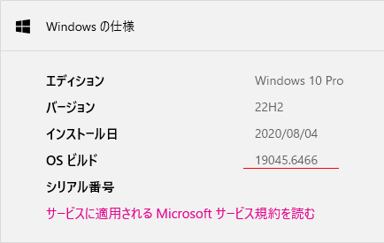

# SSTV Virtual Printer

[English README](README.md)

Windowsのいつもの「印刷」操作を、SSTV送信につなげるアプリケーションです。

既存のアマチュア無線用SSTVソフトは無線通信には強い一方、画像の作成・編集機能や、現代的な制作ソフトとの連携が十分でないことがあります。SSTV Virtual Printerはこの隙間を埋めます。ドロー、ペイント、イラスト、DTP、Officeなど、**印刷できる好きなソフトで画像を作り、そのまま印刷メニューからSSTVへ送る**ための仮想プリンタです。

アマチュア無線とMOE／創作・ファン文化が交差する機会を増やすことも、このプロジェクトの目的です。画像は画像作りが得意なソフトに任せ、このアプリは印刷結果からSSTV音声までを担当します。

> [!WARNING]
> 現在は未完成の `v0.1.0-beta` です。実際に電波を送信する前に、ダミーロードやモニター受信機で確認してください。免許、コールサイン表示、占有帯域幅、送信制御、その他の法令・運用規則への適合は利用者の責任です。

## 主な機能

- WindowsからローカルIPPプリンタとして利用できます。
- PWG Rasterで届いた印刷ジョブの先頭1ページを受け取り、送信準備画面を表示します。
- 縦横比を変えずに、選択した送信フレームへ画像全体を収めます。
- SSTVではRGB、Radiofaxでは受信状態を確認できる8段階グレースケールと、JST日時、モード、コールサインを含む固定ヘッダを必ず付与します。
- Martin 1、Scottie 1、Scottie 2、Robot 36と、実験的なRadiofax 120/288・120/576送信に対応します。
- SSTVでは細部を残すための実験的な水平解像度2xに対応します。Radiofaxは標準のサンプリングで送信します。
- アプリや印刷設定による向きの違いを、保存される−90°／+90°操作で補正できます。
- 合成後の実画像をプレビューし、選択したWindows音声出力から再生、またはWAV保存できます。
- Windowsのマスター音量を常時表示し、送信中はアプリ別音量も表示します。
- ウィンドウを閉じても通知領域で動作し、もう一度起動すると既存ウィンドウを復元します。
- **プリンタ(P)** メニューからプリンタ状態確認、登録、修復ができます。

対象は送信のみです。受信には使い慣れた既存のSSTV受信ソフトを利用してください。

## このプロジェクトが挑戦するもの

アマチュア無線は、確立された方式を保存して使うだけの場所ではありません。古い前提を個人が疑い、信号経路を自分で作り、実際の通信路で結果を確かめられる、今では数少ない研究と実験の場でもあります。SSTV Virtual Printerは、その挑戦心を刺激することを目指しています。伝統的なアナログSSTVにも、新しい接続方法と信号生成の改善によって、まだ開拓できる余地があります。

### 印刷をSSTVの共通インターフェースにする

多くのSSTVソフトは、そのソフト内へ画像を読み込み、コピーし、限られた編集機能で送信画像を準備することを前提としています。本プロジェクトは代わりに、OS標準の印刷経路をアプリケーションに依存しない画像インターフェースとして利用します。ドロー、ペイント、イラスト、DTP、Officeなど、印刷できるソフトなら、専用プラグインや個別の連携機能なしでSSTV画像の作成環境になります。「印刷できる」ことを、そのまま参加条件にする発想です。

### 伝統的なアナログSSTVから、さらに細部を引き出す

アナログSSTVの水平走査は連続信号であり、一般的な横320ピクセルという値は、信号内に明示される固定値ではなく標本化上の慣習です。そこでオプションの**水平解像度2x**では、画像を最初に320サンプルへ落とさず、640個の水平画像サンプルを保ったまま信号を合成します。VISコード、走査線数、1ラインの時間、総送信時間は変更しないため、従来の320ピクセル受信機との互換性も維持されます。

既存の受信ソフトウェアを用いた試験では、隣接ピクセル間の滲みが減り、特に細く低コントラストな線画で見かけのコントラストが改善しました。この結果は、伝統的なSSTVモードにも、送信側の信号合成を工夫することで画質を改善できる余地が残っていることを示唆します。これは新しいSSTV規格ではなく、音声経路、無線通信路、受信ソフトによって効果が変わる実験的な知見です。ぜひ実際に測定し、疑い、追試し、さらに改善してください。

## ダウンロード

[GitHub Releases](https://github.com/CQAKIBA/SSTV_Virtual_Printer/releases)からZIPを取得します。

- `win-x64` — 推奨版・テスト対象です。
- `win-arm64-experimental` — 対応機を持つ方の試用向けです。実機未検証です。

自己完結型なので、利用者が別途.NETをインストールする必要はありません。現時点ではコード署名がないため、Windows SmartScreenの警告が出る場合があります。

## 最初の送信まで

1. ReleaseのZIPを、書き込み可能なフォルダへ展開して `SstvVPrinter.Desktop.exe` を起動します。
2. **プリンタ(P) → 登録**を選び、WindowsのUACを許可します。ローカルURLは `ipp://localhost:8631/ipp/print` です。
3. コールサイン、音声出力、送信モードを選び、SSTVでは必要に応じて**水平解像度2x**を有効にします。
4. ドロー、ペイント、イラスト、DTP、Officeなど任意の印刷可能なソフトから、**SSTV Virtual Printer**へ印刷します。受け取った先頭1ページだけを使います。
5. プレビュー、コールサイン、向き、モード、音声経路を確認します。向きが違う場合は−90°／+90°で補正します。
6. **送信**で音声を再生するか、**WAV保存**でファイルへ保存します。本アプリからWindows音量を変更することはありません。

コールサイン、モード、2x、回転、音声出力、自動起動設定は前回値を保持します。ウィンドウの×は通知領域へ格納する動作で、完全終了は**ファイル(F) → 終了**です。

## 無線・音声に関する注意

PTT制御は**未実装**です。VOXを利用すると、意図しないシステム音でも送信機が動作する可能性があります。また、デバイスやアプリ別ミキサーの値によっては過大な音声が出ます。送信機へ接続する前に経路とレベルを確認してください。音量表示は安全のため読み取り専用です。

IPP待受は標準でループバックのみにバインドします。LANプリントサーバとしての利用は未サポートの実験的用途で、信頼できないネットワーク向けの防御は行っていません。

## ベータ版の制限

- 検証済み開発環境はWindows 11です。
- Windows 10はベストエフォート対応で、**バージョン22H2（OSビルド19045）へ更新し、最新のWindows Updateを適用してください**。古い21H2／OSビルド19044環境では、必要なIPPセットアップ経路が不足し、通常の手順ではプリンタを登録できないことを確認しています。バージョンは、**スタートメニューを右クリック → システム → Windowsの仕様**にある**バージョン**と**OSビルド**で確認できます。Windows 10 x64の更新済み実機では、登録と印刷データの到達を確認しています。

  

  *確認例：バージョン22H2、OSビルド19045。末尾の更新番号はWindows Updateの適用状況によって異なります。*

- ARM64版はビルド確認のみで、ARM64実機では未検証です。
- ローカルIPP／Microsoft IPP Class Driver経路はまだ実験段階です。
- PTT機能と受信機能はありません。
- 印刷ジョブの先頭1ページだけを処理します。
- 水平解像度2xは限定的な受信試験に成功していますが、実験的機能です。
- Radiofax送信は実験的機能で、実際の気象FAX機器や無線受信経路との互換試験はまだ行っていません。異常に長い送信を防ぐため、入力画像の縦横比は1:2から2:1までに制限します。
- A4縦ページの送信時間は、制御信号を含めてRadiofax 120/288で約11分17秒、120/576で約21分44秒です。実際の時間は合成後のページ比率によって変わります。
- バイナリはコード署名されていません。

## 開発者向け

[ビルドと検証](docs/BUILDING.md)、[アーキテクチャ](docs/ARCHITECTURE.md)、[コントリビューション](CONTRIBUTING.md)を参照してください。脆弱性報告については[SECURITY.md](SECURITY.md)に記載しています。

## ライセンス

[MIT License](LICENSE)で公開します。

Copyright (c) 2026 Daisuke JA1UMW / CQAKIBA.TOKYO
